# Endnutzer Dokumentation

### Autoren
1. **Tom Weber** *(Dokumentationsteil: Allgemein, Student)*
2. **Paulina Clauss** *(Dokumentationsteil: Dozent)*
3. **Monika Pjano** *(Dokumentationsteil: Admin)*

### Reviewer (Prüfer)
1. **Luca Baeck**
2. **Okan Soenmez**
3. **Leon Priemer**
4. **Iven Stahl**
5. **Max Meinel**

---

## 0. Allgemein

**Voraussetzungen für den Systemzugang**
Um sich an der Plattform anmelden zu können, ist ein gültiges Benutzerkonto im zentralen Identitätsmanagementsystem (Keycloak) zwingend erforderlich. Dies gilt ausnahmslos für alle Benutzergruppen.

Damit der Login erfolgreich durchgeführt werden kann, müssen in Keycloak folgende Attribute zwingend hinterlegt sein:
* Vorname
* Nachname
* E-Mail-Adresse
* Zugewiesene Rolle (Student, Lehrer oder Admin)

Fehlt eine dieser Informationen, gibt es einen Fehler.

**Hinweis zur Struktur dieser Dokumentation**
Die nun folgende Endnutzer-Dokumentation ist strikt nach Rollen getrennt aufgebaut. Jede Sektion (Student, Dozent, Admin) ist als eigenständige und vollumfängliche Anleitung konzipiert.

Aufgrund dieses Aufbaus kann es zu inhaltlichen Dopplungen zwischen den einzelnen Kapiteln kommen. Dies ist bewusst so gewählt: Jede Nutzergruppe erhält genau die Informationen, die für sie relevant sind, ohne bei funktionsübergreifenden Themen zwischen verschiedenen Teilen des Dokuments hin- und herspringen zu müssen.

---

### Rechte- und Rollenübersicht

Die folgende Tabelle gibt einen schnellen Überblick über die Berechtigungen der verschiedenen Benutzerklassen innerhalb des App Stores.

| Funktion / Aktion | Student | Dozent | Admin |
| :--- | :---: | :---: | :---: |
| Login am System (via Keycloak) | ✅ | ✅ | ✅ |
| Öffentliche Apps einsehen | ✅ | ✅ | ✅ |
| Private Apps einsehen | ❌ | ✅ (Nur eigene) | ✅ (Alle) |
| Neue Apps hinzufügen (zur Prüfung einreichen) | ❌ | ✅ | ✅ |
| Sichtbarkeit einer App auf „Privat" stellen | ❌ | ✅ (Nur eigene) | ✅ (Alle) |
| App-Versionen freigeben, ablehnen oder widerrufen | ❌ | ❌ | ✅ |
| Neue Deployments konfigurieren und starten | ❌ | ✅ | ✅ |
| Deployments einsehen | ✅ (Nur als Mitglied) | ✅ (Eigene + Kurs-Studenten) | ✅ (Alle) |
| Eigene Zugangsdaten in zugewiesenen Deployments einsehen | ✅ | ✅ | ✅ |
| Zugangsdaten aller Mitglieder eines Deployments einsehen | ❌ | ✅ (als Besitzer) | ✅ |
| Kurse erstellen und Mitglieder verwalten | ❌ | ✅ | ✅ |
| Admin-Einstellungen verwalten (empfohlene Apps, Deploy-Version) | ❌ | ❌ | ✅ |

---

## 1. Studenten

Willkommen im App Store! Diese Dokumentation führt Sie durch die wichtigsten Funktionen, die Ihnen als Student in der Plattform zur Verfügung stehen.

---

### Login und Dashboard

Der Einstieg in die Plattform erfolgt über den regulären Login. Sie können sich entweder mit Ihrem **Benutzernamen und Passwort** oder Ihrer **E-Mail-Adresse und Passwort** anmelden.

<figure style="margin-bottom: 30px;">
  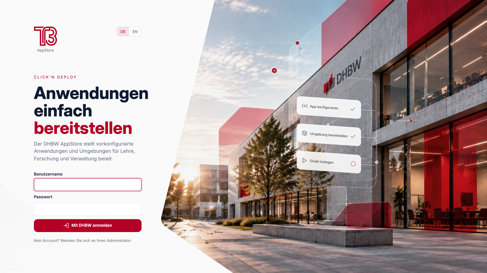
  <figcaption style="font-size: 0.9em; color: #555;">Keycloak Login</figcaption>
</figure>

Nach erfolgreichem Login landen Sie direkt auf dem **Dashboard**. Hier erhalten Sie einen schnellen Überblick über:
* Ihre zugewiesenen Deployments
* Die verfügbaren Apps im Store

<figure style="margin-bottom: 30px;">
  
  <figcaption style="font-size: 0.9em; color: #555;">Dashboard: Überblick über Deployments und Apps</figcaption>
</figure>

---

### Profil und Einstellungen

Klicken Sie oben rechts auf Ihr **Nutzer-Icon**, öffnet sich ein kleines Menü. Hier können Sie sich **abmelden** oder Ihr **Profil** aufrufen.

In der Profilansicht sehen Sie alle relevanten Account-Daten auf einen Blick:
* Vorname, Nachname und E-Mail-Adresse
* Ihren zugewiesenen Kurs
* Ihre Rolle (Student)
* Registrierungsdatum sowie System-IDs (Benutzer-ID und Keycloak-ID)

<figure style="margin-bottom: 30px;">
  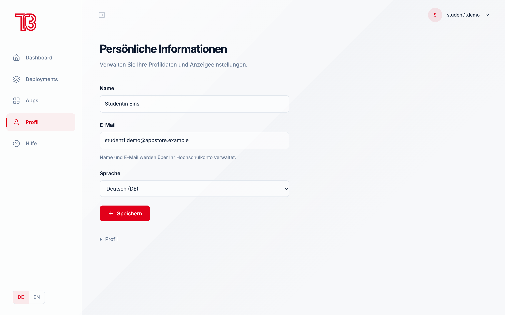
  <figcaption style="font-size: 0.9em; color: #555;">Profil: Übersicht der eigenen Benutzerdaten</figcaption>
</figure>

---

### Apps einsehen

Über den Menüpunkt **Apps** in der linken Seitenleiste gelangen Sie zur App-Übersicht. Als Student können Sie alle öffentlichen Apps im Store einsehen. Das Anlegen neuer Apps ist Lehrkräften und Admins vorbehalten.

Wenn Sie in der App-Übersicht auf eine der angezeigten Kacheln klicken, öffnet sich die Detailseite der jeweiligen App.

**Allgemeine Übersicht:**
Oben auf der Seite sehen Sie den Namen und das Logo der App sowie die Beschreibung des Entwicklers. Hier finden Sie spezifische Informationen wie Erklärungen zu Features oder Schätzungen zur Deployment-Dauer.

**Deployment-Button:**
Als Student haben Sie keine Berechtigung, selbst ein Deployment zu starten. Der Button ist für Sie gesperrt. Diese Ansicht dient Ihnen rein der Information.

<figure style="margin-bottom: 30px;">
  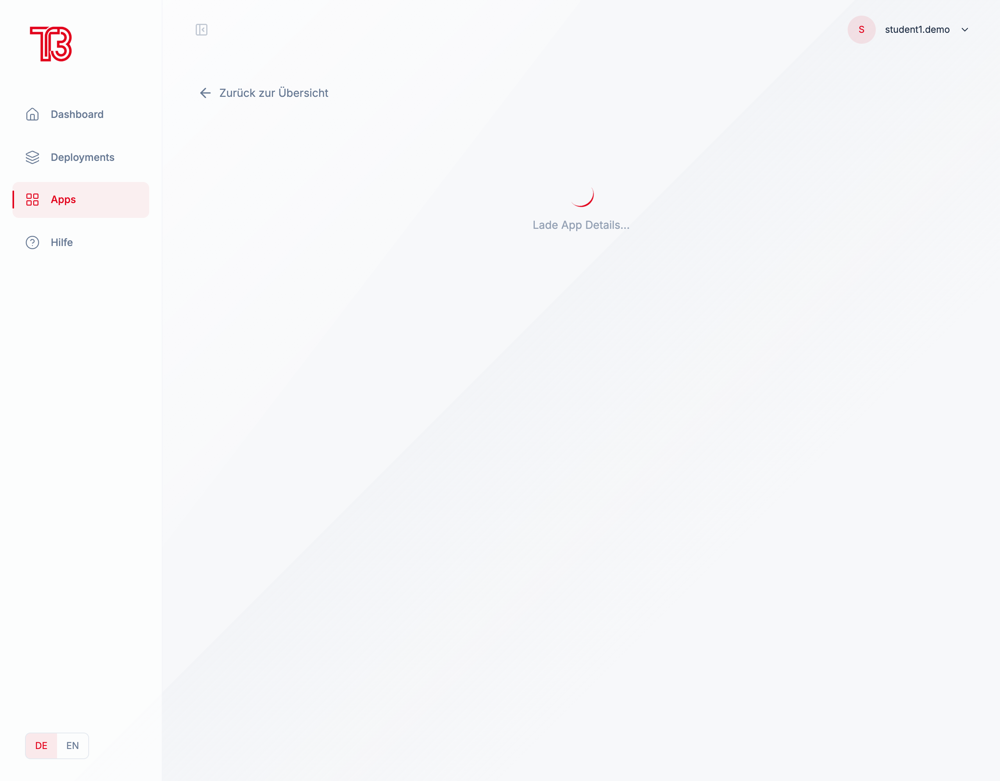
  <figcaption style="font-size: 0.9em; color: #555;">App-Details: Übersicht und Beschreibung</figcaption>
</figure>

---

### Deployments und Zugangsdaten einsehen

**Wichtig:** Als Student können Sie *keine* eigenen Deployments starten oder konfigurieren. Diese Aufgabe übernehmen Lehrkräfte oder Admins für Sie.

Über den Menüpunkt **Deployments** in der linken Seitenleiste sehen Sie alle Deployments, denen Sie (bzw. Ihr Team) zugewiesen wurden.

* **Übersicht:** Liste der aktiven Deployments inklusive Status (z. B. „Erfolgreich").
* **Details:** Klicken Sie auf ein Deployment, um allgemeine Informationen zur genutzten App, dem Besitzer und der Team-Zuteilung zu sehen.
* **Zugangsdaten einsehen:** In der Sektion „Teams & Mitglieder" finden Sie neben Ihrem Namen Ihre persönlichen Zugangsdaten für diese App. Das Passwort ist zunächst verborgen und lässt sich über das Augen-Symbol sichtbar machen. Über kleine Symbole können Sie die Daten in die Zwischenablage kopieren.
* **Zugang erneut senden:** Über diesen Button können Sie sich die Zugangsdaten erneut per E-Mail zuschicken lassen.

> **Hinweis:** Aus Sicherheitsgründen können Sie in der Team-Liste nur Ihre eigenen Zugangsdaten einsehen, nicht die der anderen Teammitglieder.

Wenn ein Deployment noch läuft (Status „Ausstehend" oder „Läuft"), sehen Sie den aktuellen Status automatisch ohne Neuladen.

<figure style="margin-bottom: 30px;">
  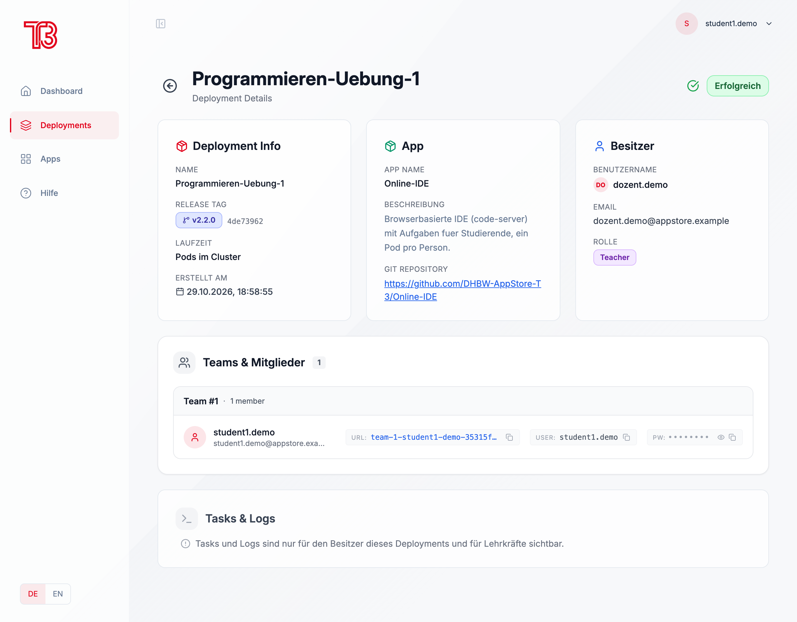
  <figcaption style="font-size: 0.9em; color: #555;">Deployment Details: Übersicht der App-Informationen und des Status</figcaption>
</figure>

<figure style="margin-bottom: 30px;">
  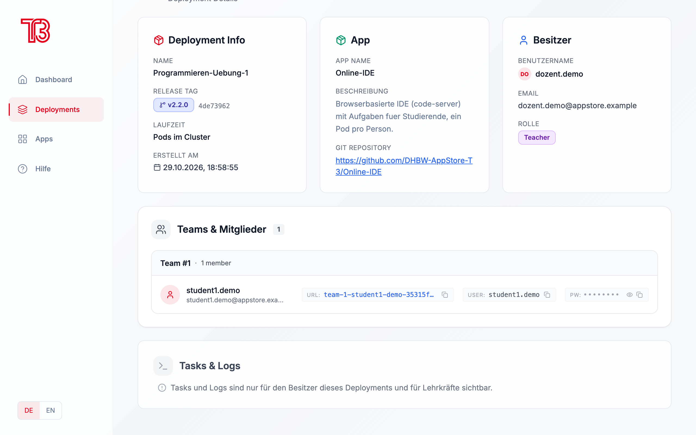
  <figcaption style="font-size: 0.9em; color: #555;">Teams & Mitglieder: Eigene Zugangsdaten einsehen, kopieren und bei Bedarf erneut anfordern</figcaption>
</figure>

---

### Hilfe und Support

Ganz unten in der linken Seitenleiste finden Sie den Punkt **Hilfe**.

Diese Seite dient als zentrale Anlaufstelle für Fragen und Probleme:
* **Wenn etwas nicht funktioniert:** Checklisten zur Fehlerbehebung.
* **Schritt-für-Schritt-Anleitungen:** Erklärungen zu grundlegenden Prozessen der Plattform.
* **Nützliche Links:** Verlinkungen zum Projekt-Repository auf GitHub und zur technischen Dokumentation.

<figure style="margin-bottom: 30px;">
  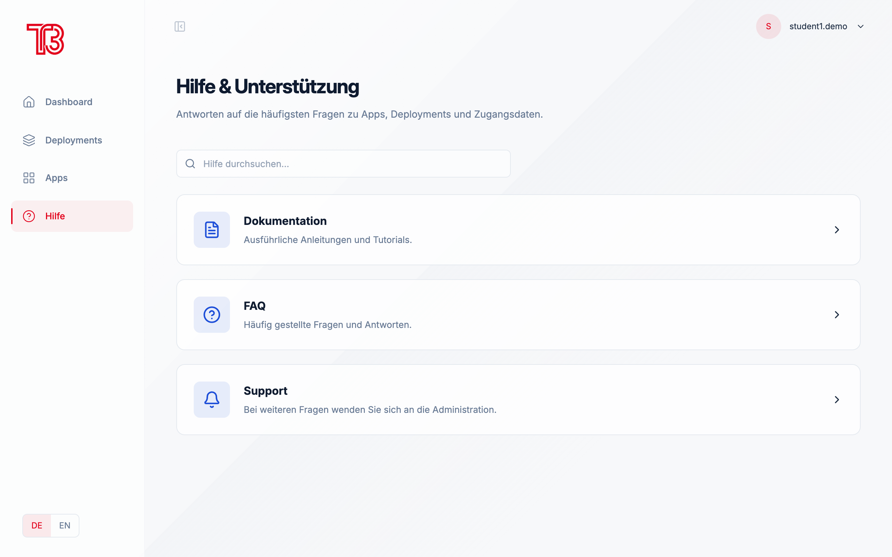
  <figcaption style="font-size: 0.9em; color: #555;">Hilfe & Q/A: Support, Anleitungen und weiterführende Links</figcaption>
</figure>

---

## 2. Dozent

Willkommen im App Store! Diese Dokumentation führt Sie durch die wichtigsten Funktionen, die Ihnen als Dozent in der Plattform zur Verfügung stehen.

---

### Login und Dashboard

Der Einstieg in die Plattform erfolgt über den regulären Login. Sie können sich entweder mit Ihrem **Benutzernamen und Passwort** oder Ihrer **E-Mail-Adresse und Passwort** anmelden.

<figure style="margin-bottom: 30px;">
  
  <figcaption style="font-size: 0.9em; color: #555;">Keycloak Login</figcaption>
</figure>

Nach erfolgreichem Login landen Sie direkt auf dem **Dashboard**. Hier erhalten Sie einen schnellen Überblick über:
* Ihre Deployments
* Die verfügbaren Apps im Store
* Ihre Kurse

<figure style="margin-bottom: 30px;">
  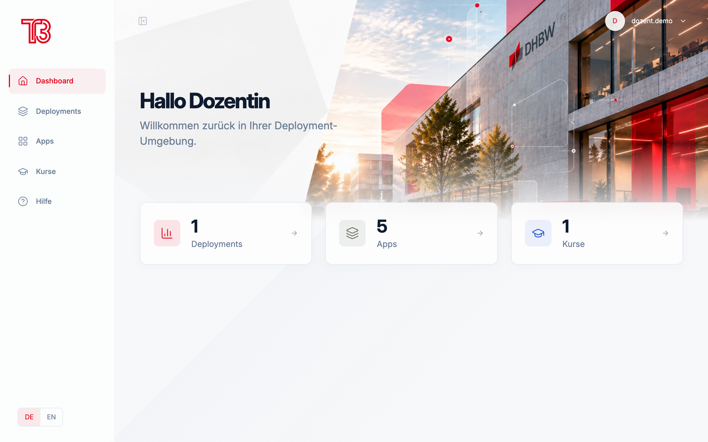
  <figcaption style="font-size: 0.9em; color: #555;">Dashboard</figcaption>
</figure>

---

### Profil und Einstellungen

Klicken Sie oben rechts auf Ihr **Nutzer-Icon**, öffnet sich ein kleines Menü. Hier können Sie sich **abmelden** oder Ihr **Profil** aufrufen.

In der Profilansicht sehen Sie alle relevanten Account-Daten auf einen Blick:
* Vorname, Nachname und E-Mail-Adresse
* Ihre Rolle (Dozent)
* Registrierungsdatum sowie System-IDs (Benutzer-ID und Keycloak-ID)

<figure style="margin-bottom: 30px;">
  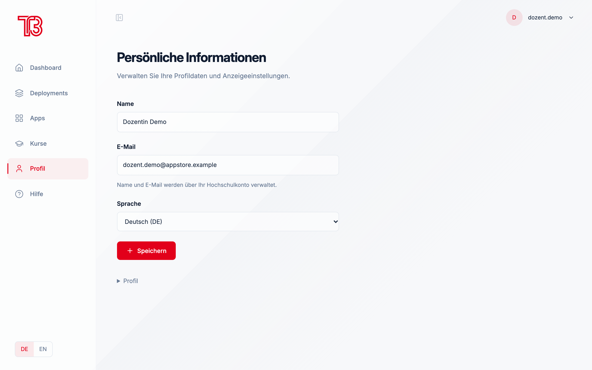
  <figcaption style="font-size: 0.9em; color: #555;">Profil: Übersicht der eigenen Benutzerdaten</figcaption>
</figure>

---

### Apps anlegen und einreichen

Über den Menüpunkt **Apps** in der linken Seitenleiste gelangen Sie zur App-Übersicht. Als Dozent können Sie neue Apps hinzufügen und zur Überprüfung vorschlagen.

1. Klicken Sie in der App-Übersicht oben rechts auf den Button **+ App hinzufügen**.
2. Vergeben Sie einen **Namen** und tragen Sie eine **Beschreibung** ein (Markdown wird unterstützt).
3. (Optional) Laden Sie ein App-Logo hoch.
4. Fügen Sie den **Link zu Ihrem GitHub-Repository** (als HTTPS-Link) ein.
5. **Sichtbarkeit:** Wählen Sie zwischen **Öffentlich** und **Privat**.
6. Haken Sie die Option **„Alle Versionen einreichen"** an, damit Ihre Git-Tags als Versionen für das Admin-Review übermittelt werden.
7. **GitHub Collaborator (nur bei privaten Repositories):** Wenn Ihr Repository *privat* ist, müssen Sie den technischen User als Collaborator einladen. Welchen GitHub-Account Sie einladen müssen, erfahren Sie von Ihrer Administration.
8. Klicken Sie auf **Hinzufügen**.

<figure style="margin-bottom: 30px;">
  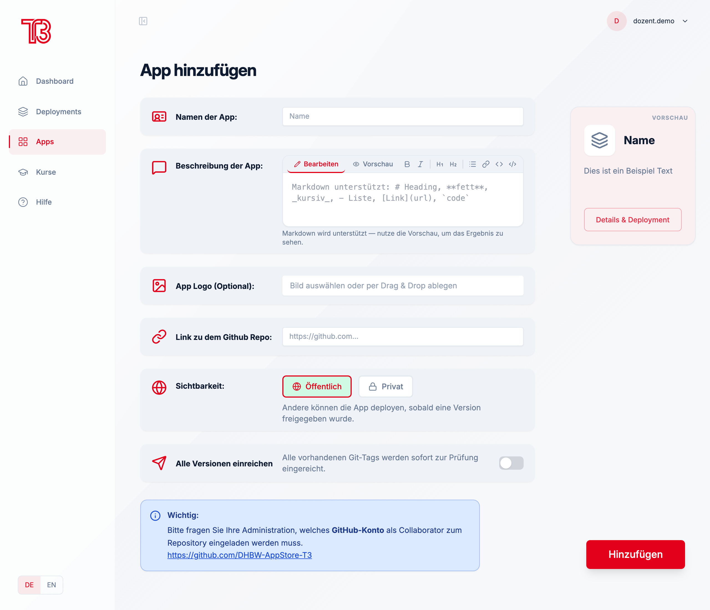
  <figcaption style="font-size: 0.9em; color: #555;">App hinzufügen: Einreichen einer neuen App für den Store</figcaption>
</figure>

---

### App-Details einsehen

Wenn Sie auf eine App-Kachel klicken, öffnet sich die Detailseite. Diese bietet Ihnen eine Übersicht der App und ermöglicht es Ihnen, ein Deployment zu starten.

**Versionsauswahl & Deployment:**
Auf der rechten Seite befindet sich eine fixierte Box. Wählen Sie die gewünschte Version aus und klicken Sie auf den Button **Jetzt Deployen**, um den Deployment-Prozess zu starten.

<figure style="margin-bottom: 30px;">
  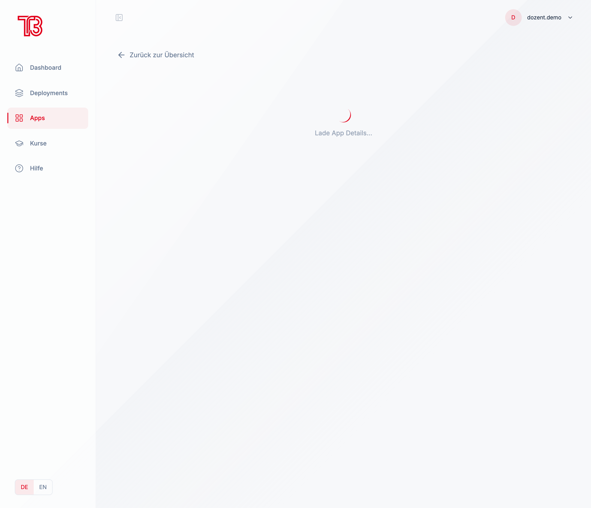
  <figcaption style="font-size: 0.9em; color: #555;">App-Details: Übersicht und Deployment starten</figcaption>
</figure>

Wenn Sie die App selbst hinzugefügt haben, stehen Ihnen zusätzlich **Bearbeiten** und **Löschen** oben rechts zur Verfügung. Über den Tab **App Store** steuern Sie die Sichtbarkeit und können Versionen zur Freigabe einreichen.

---

### Kurse verwalten

Über den Menüpunkt **Kurse** sehen Sie alle auf der Plattform angelegten Kurse. Bearbeiten oder löschen können Sie jedoch nur die Kurse, in denen Sie selbst als Dozent hinterlegt sind.

**Neuen Kurs anlegen:** Klicken Sie auf **Kurs erstellen** oder **Ersten Kurs anlegen**. Tragen Sie im Fenster den gewünschten Namen ein und bestätigen Sie mit **Erstellen**.

<figure style="margin-bottom: 30px;">
  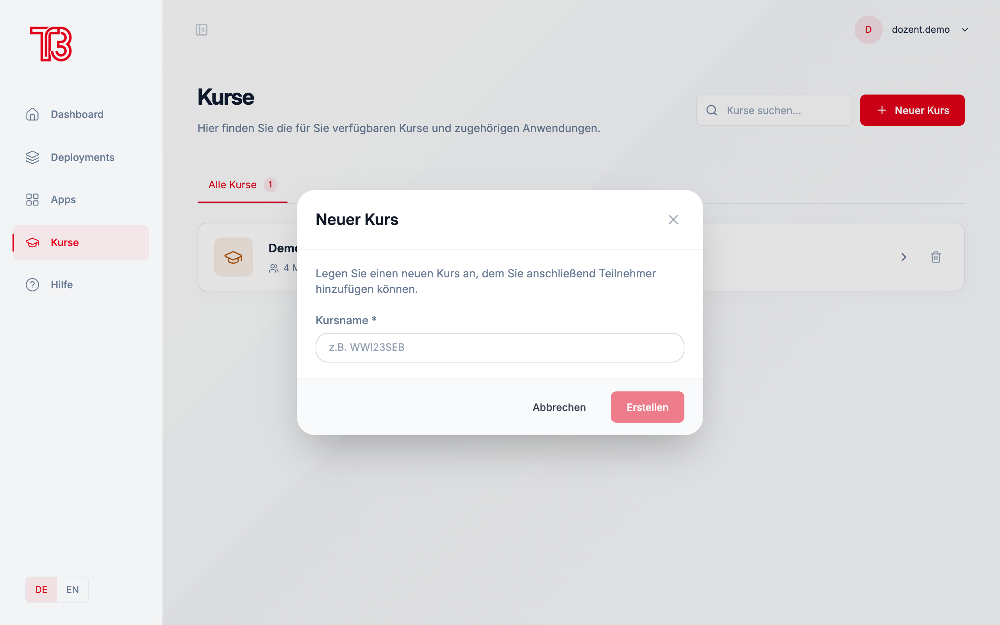
  <figcaption style="font-size: 0.9em; color: #555;">Kurs anlegen: Kursnamen auswählen</figcaption>
</figure>

**Mitglieder hinzufügen:** Öffnen Sie die Detailseite eines Kurses und klicken Sie auf **Mitglied hinzufügen**. Suchen Sie nach E-Mail-Adresse oder Nutzernamen und fügen Sie die gewünschten Studierenden hinzu.

<figure style="margin-bottom: 30px;">
  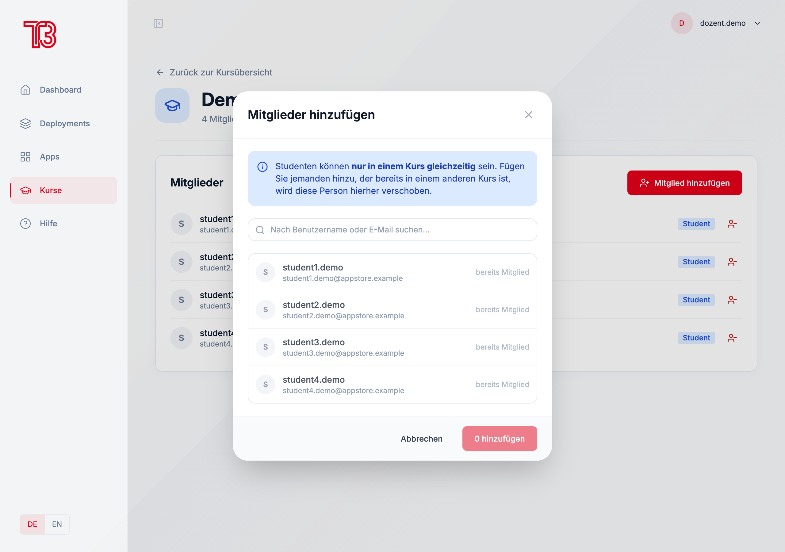
  <figcaption style="font-size: 0.9em; color: #555;">Kurs-Mitglieder hinzufügen</figcaption>
</figure>

**Mitglieder entfernen:** Auf der Detailseite des Kurses sehen Sie alle aktuellen Mitglieder. Rechts neben jedem Eintrag finden Sie ein Symbol, um das Mitglied aus dem Kurs zu entfernen.

**Kursnamen bearbeiten:** Neben dem Kursnamen finden Sie ein Stift-Symbol. Bestätigen Sie Ihre Eingabe mit dem Haken oder verwerfen Sie die Änderung mit dem Kreuz.

**Kurse löschen:** In der Kursübersicht finden Sie in jeder Kachel ein Mülleimer-Symbol.

> **Hinweis:** Jeder Studierende kann immer nur in *einem* Kurs sein. Fügen Sie jemanden hinzu, der bereits in einem anderen Kurs eingetragen ist, wird die Person automatisch in den neuen Kurs verschoben.

<figure style="margin-bottom: 30px;">
  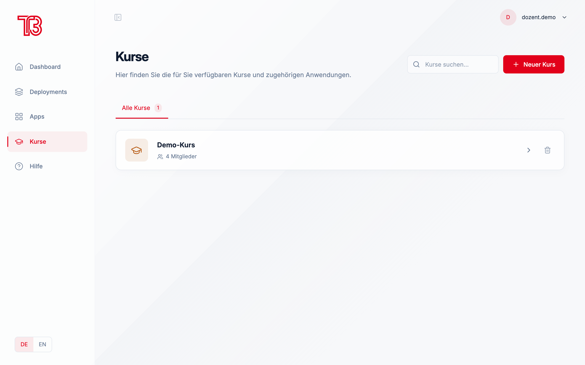
  <figcaption style="font-size: 0.9em; color: #555;">Auflistung der Kurse</figcaption>
</figure>

---

### Deployments

Über den Menüpunkt **Deployments** finden Sie alle Deployments, die Sie erstellt haben.

### Deployment erstellen

> **Hinweis:** Um ein Deployment zu erstellen, muss im Vorfeld bereits eine App angelegt und mindestens eine Version freigegeben worden sein.

1. Klicken Sie in der Deployment-Übersicht oben rechts auf **+ Neues Deployment**.

<figure style="margin-bottom: 30px;">
  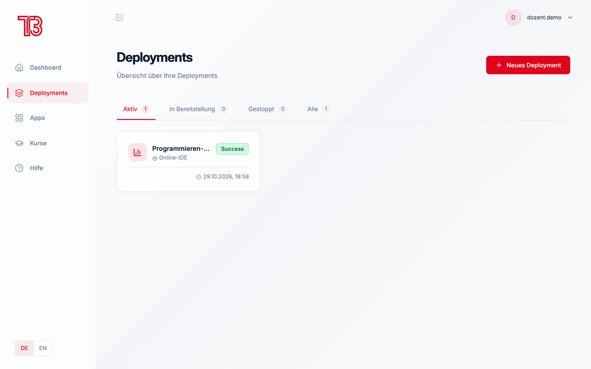
  <figcaption style="font-size: 0.9em; color: #555;">Deployment erstellen</figcaption>
</figure>

2. Wählen Sie eine App aus, indem Sie auf **Details & Deployment** klicken. Auf der App-Detailseite wählen Sie rechts die gewünschte Version und klicken auf **Jetzt Deployen**.

<figure style="margin-bottom: 30px;">
  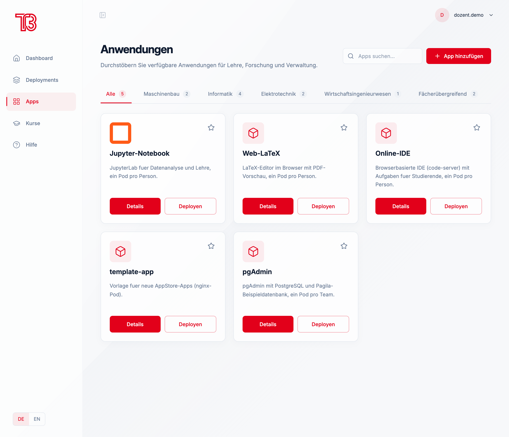
  <figcaption style="font-size: 0.9em; color: #555;">Deploymentprozess: App auswählen</figcaption>
</figure>

3. **Schritt Konfiguration:** Vergeben Sie einen Namen für das Deployment. Fügen Sie dann einen kompletten Kurs oder einzelne Studenten hinzu. Klicken Sie auf **Weiter**.

<figure style="margin-bottom: 30px;">
  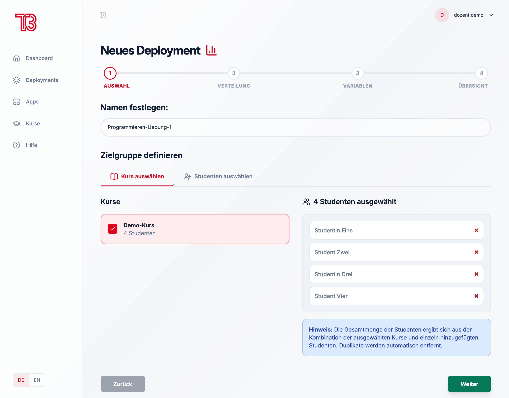
  <figcaption style="font-size: 0.9em; color: #555;">Studenten auswählen: Kurse oder Studenten hinzufügen</figcaption>
</figure>

4. **Schritt Verteilung:** Bilden Sie die Teams. Es gibt drei Möglichkeiten:
   * **Eine Gruppe:** Alle ausgewählten Studenten in einem einzigen Team.
   * **Jeder Nutzer einzeln:** Jeder Student bildet ein eigenes Team.
   * **Individuell:** Legen Sie über die Plus- und Minus-Buttons eine beliebige Anzahl an Teams fest.

   Verteilen Sie die Studenten über **Zufall** automatisch oder per Drag-and-Drop manuell. Über **Zurücksetzen** setzen Sie die Zuteilung zurück. Bestätigen Sie mit **Weiter**.

<figure style="margin-bottom: 30px;">
  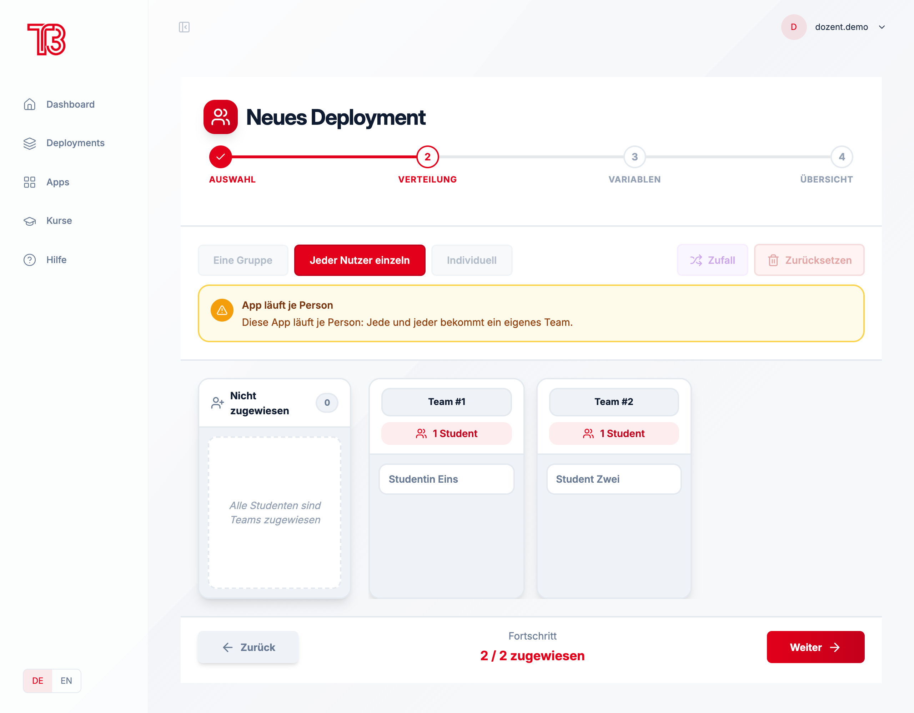
  <figcaption style="font-size: 0.9em; color: #555;">Studenten verteilen: Gruppen und Zuteilung auswählen</figcaption>
</figure>

5. **Schritt Variablen:** Konfigurieren Sie die App-spezifischen Einstellungen (abhängig von der jeweiligen App).
   * **Ressourcen (CPU & RAM):** Falls die App eine Ressourcenauswahl erlaubt, erscheint ein Schieberegler-Bereich. Bei **Container-Apps** wird in halben vCPUs und MiB skaliert; bei **VM-Apps (KubeVirt)** in ganzen vCPUs und GiB.
   * **Netzwerkeinstellungen:** Falls die App Netzwerkoptionen freigibt (Internetzugang oder Pod-Netzwerk), erscheint ein ausklappbarer Bereich „Netzwerkeinstellungen". Aktivieren Sie die gewünschten Optionen.
   * **Standardwerte:** Die App-Variablen sind bereits vorausgefüllt.
   * **Geltungsbereich (Scope):** Je nach App werden Variablen für das gesamte Deployment, pro Team oder pro Nutzer abgefragt.
   * **Info-Button:** Über das Info-Symbol (i) neben dem Variablennamen öffnet sich ein Tooltip mit der Beschreibung und Formatierungshinweisen.
   * **Datei-Uploads:** Manche Apps erlauben das Hochladen von Dateien per Drag-and-Drop. Eine einzelne Datei darf **maximal 2 MB** groß sein, das Gesamtvolumen **maximal 10 MB**.

<figure style="margin-bottom: 30px;">
  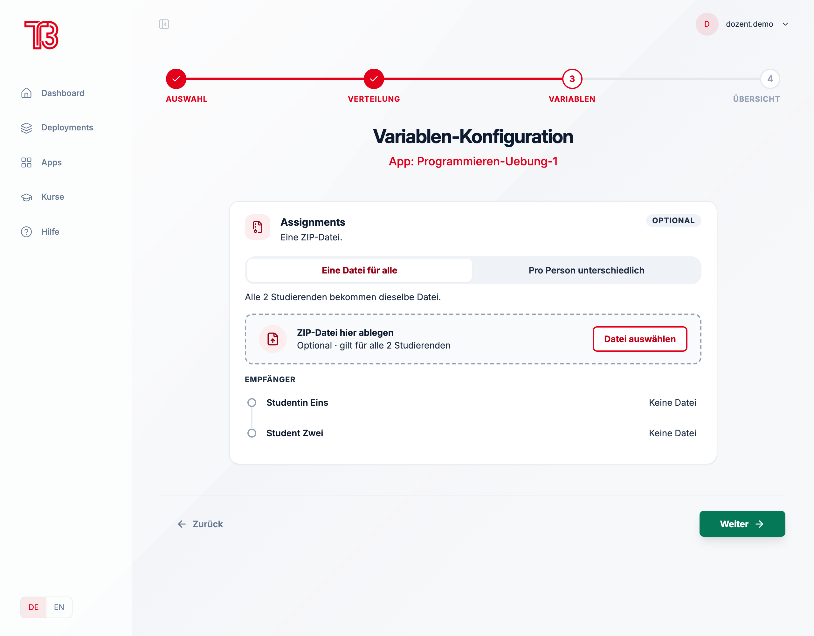
  <figcaption style="font-size: 0.9em; color: #555;">Variablen konfigurieren: Einstellungen und Datei-Uploads</figcaption>
</figure>

6. **Schritt Übersicht:** Prüfen Sie die Zusammenfassung. Über **Zurück** können Sie jederzeit einen Schritt zurückgehen. Klicken Sie auf **Deployen**, um den Vorgang abzuschließen.

<figure style="margin-bottom: 30px;">
  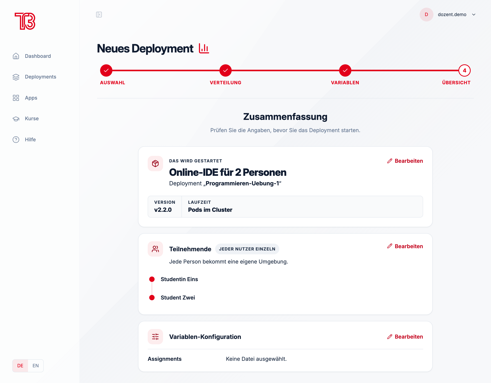
  <figcaption style="font-size: 0.9em; color: #555;">Übersicht: Zusammenfassung vor dem Deployen</figcaption>
</figure>

---

### Deployment-Details und Zugangsdaten einsehen

Klicken Sie auf ein Deployment in der Übersicht, gelangen Sie zur Detailansicht.

Oben rechts stehen Ihnen zwei Aktionen zur Verfügung:
* **Pausieren / Fortsetzen:** Hält alle Pods an und startet sie später wieder. Die Daten bleiben erhalten.
* **Löschen:** Entfernt das Deployment unwiderruflich. Der Namespace mit allen Pods und Daten wird gelöscht.

#### Übersicht & Metadaten

* **Deployment Info:** Name, Release-Tag und Erstellungsdatum.
* **App:** App-Name, Beschreibung und Link zum Git-Repository.
* **Besitzer:** Nutzername, E-Mail und Rolle der Person, die das Deployment gestartet hat.
* **Teams & Mitglieder:** Alle Teams und zugewiesenen Studierenden. Sie können Zugangsdaten einzelner Studierender einsehen und bei Bedarf über **Zugang erneut senden** per E-Mail versenden.

<figure style="margin-bottom: 30px;">
  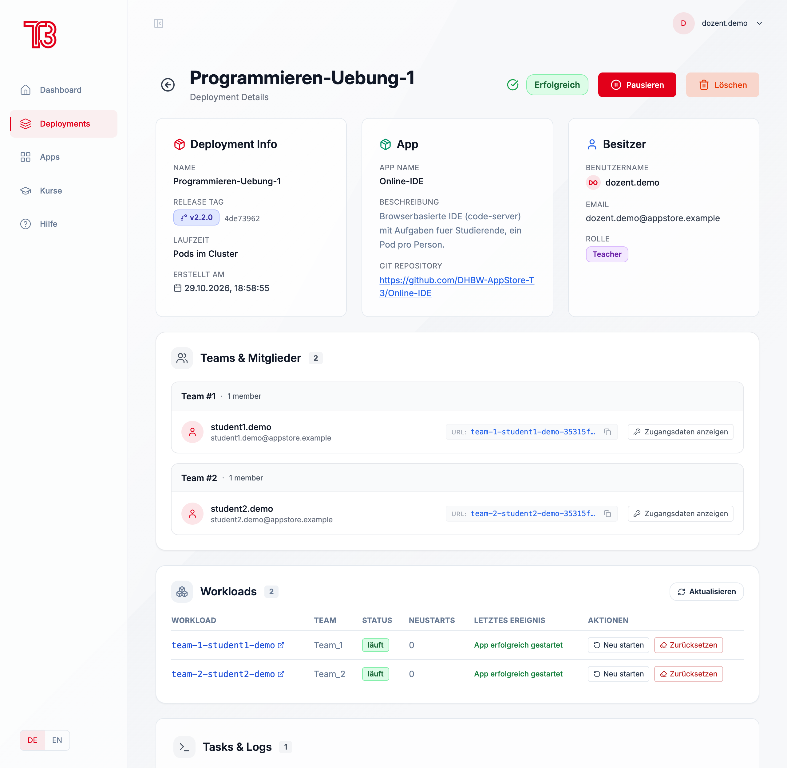
  <figcaption style="font-size: 0.9em; color: #555;">Deployment Details: Übersicht</figcaption>
</figure>

#### Workloads

In diesem Bereich sehen Sie alle laufenden Pods des Deployments:

* **Neu starten:** Startet einen einzelnen Pod neu. Die Daten bleiben erhalten.
* **Zurücksetzen:** Löscht die Daten eines Workloads und startet ihn leer neu.

<figure style="margin-bottom: 30px;">
  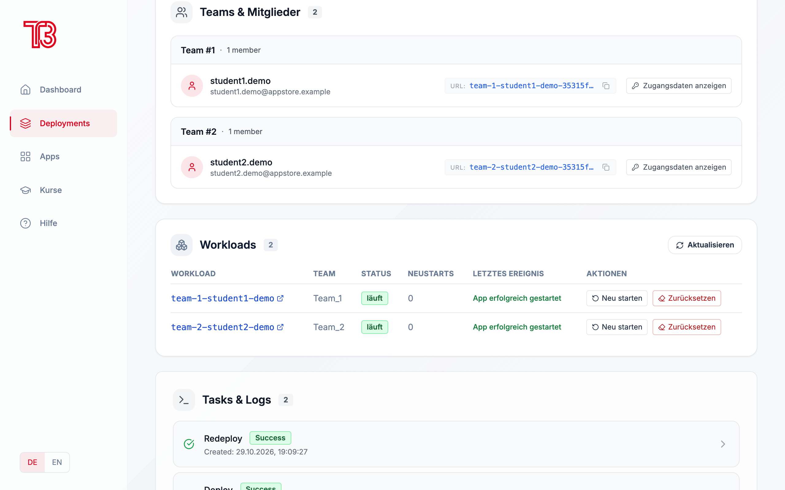
  <figcaption style="font-size: 0.9em; color: #555;">Deployment Details: Workloads</figcaption>
</figure>

#### Tasks & Logs

* **Task-Übersicht:** Alle ausgeführten Tasks mit Status sowie Start- und Endzeitstempel.
* **Logs:** Zeitgestempelte Konsolenausgaben des Deployments. Über das Kopieren-Symbol können Sie den gesamten Log in die Zwischenablage übernehmen.

> **Hinweis:** Tasks und Logs sind nur für den Besitzer des Deployments und für Lehrkräfte sichtbar.

<figure style="margin-bottom: 30px;">
  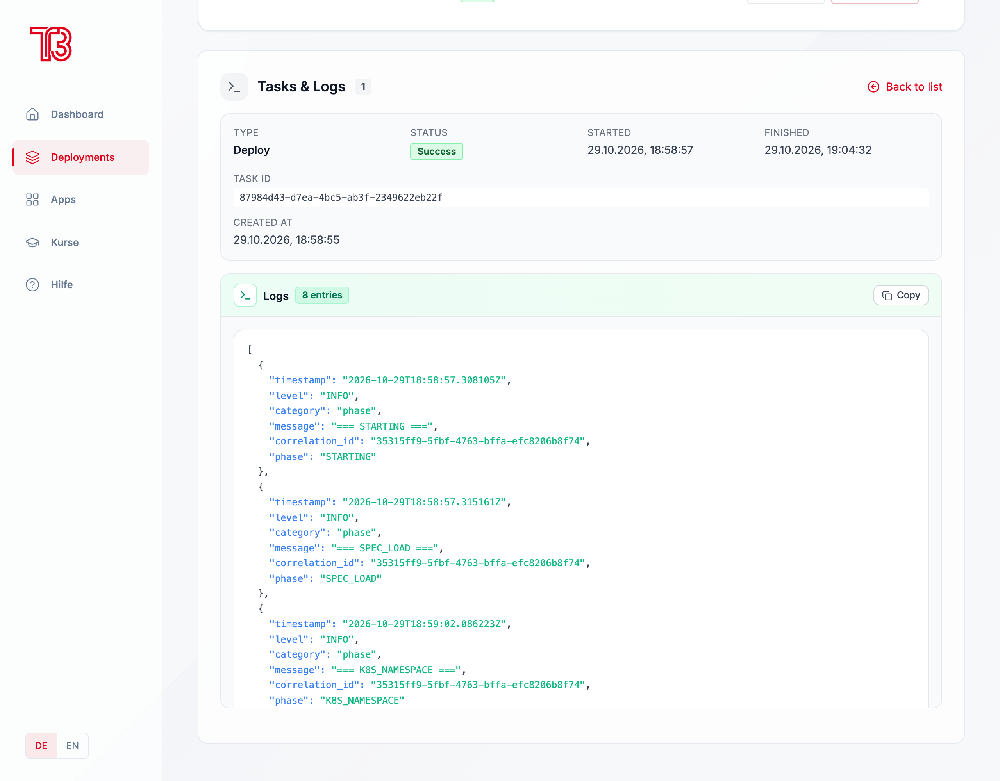
  <figcaption style="font-size: 0.9em; color: #555;">Deployment Details: Tasks und Logs</figcaption>
</figure>

#### Echtzeit-Logs

Während eines laufenden Deployments können Sie in der Detailseite den Live-Fortschritt verfolgen.

<figure style="margin-bottom: 30px;">
  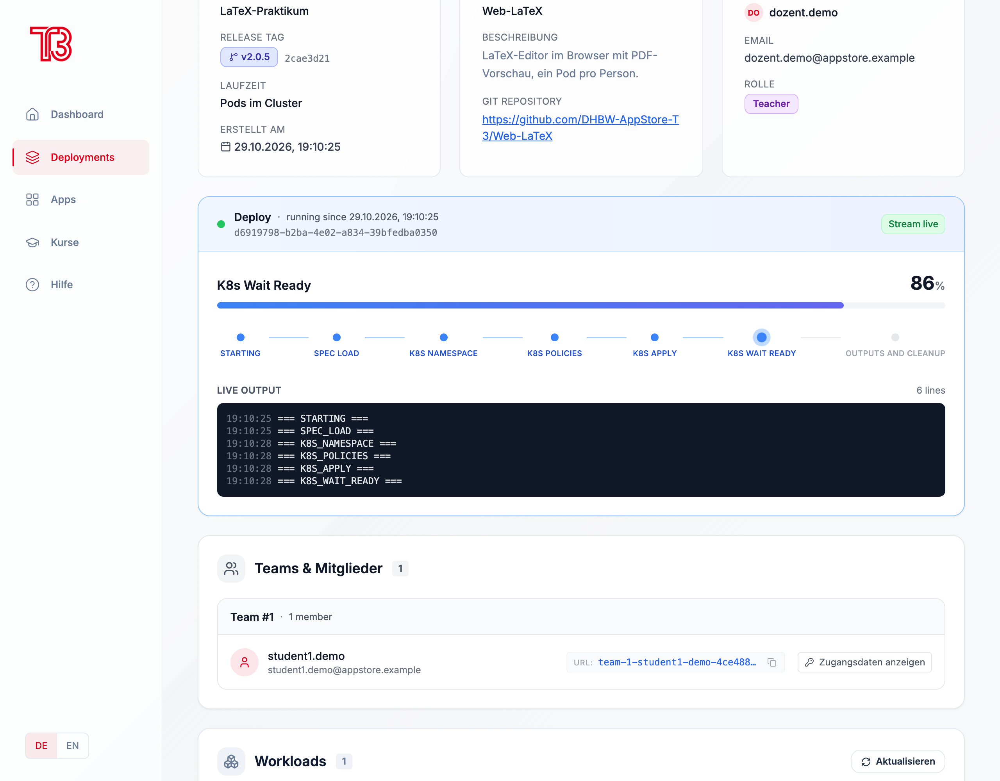
  <figcaption style="font-size: 0.9em; color: #555;">Echtzeit-Logs während des Deployments</figcaption>
</figure>

---

### Hilfe und Support

Ganz unten in der linken Seitenleiste finden Sie den Punkt **Hilfe**.

* **Wenn etwas nicht funktioniert:** Checklisten zur Fehlerbehebung.
* **Schritt-für-Schritt-Anleitungen:** Erklärungen zu grundlegenden Prozessen der Plattform.
* **Nützliche Links:** Verlinkungen zum Projekt-Repository und zur technischen Dokumentation.

<figure style="margin-bottom: 30px;">
  
  <figcaption style="font-size: 0.9em; color: #555;">Hilfe & Q/A: Support, Anleitungen und weiterführende Links</figcaption>
</figure>

---

## 3. Admin

Willkommen im App Store! Diese Dokumentation führt Sie durch die wichtigsten Funktionen, die Ihnen als Admin in der Plattform zur Verfügung stehen.

---

### Login und Dashboard

Der Einstieg in die Plattform erfolgt über den regulären Login. Sie können sich entweder mit Ihrem **Benutzernamen und Passwort** oder Ihrer **E-Mail-Adresse und Passwort** anmelden.

<figure style="margin-bottom: 30px;">
  
  <figcaption style="font-size: 0.9em; color: #555;">Keycloak Login</figcaption>
</figure>

Nach erfolgreichem Login landen Sie direkt auf dem **Dashboard**. Hier erhalten Sie einen schnellen Überblick über Ihre Deployments, die verfügbaren Apps und Ihre Kurse.

<figure style="margin-bottom: 30px;">
  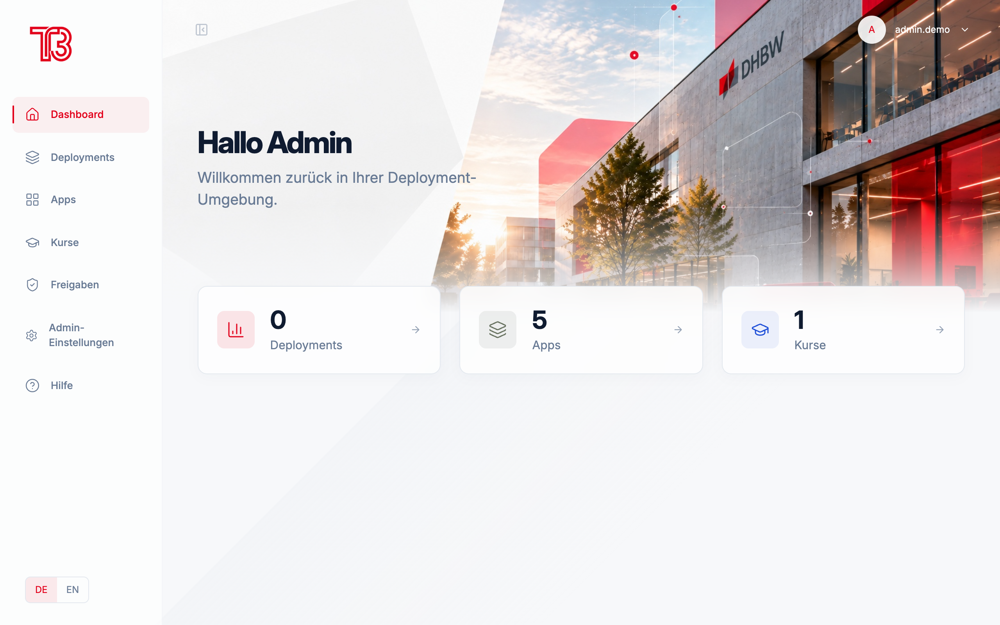
  <figcaption style="font-size: 0.9em; color: #555;">Dashboard (Admin-Ansicht)</figcaption>
</figure>

---

### Profil und Einstellungen

Klicken Sie oben rechts auf Ihr **Nutzer-Icon**, öffnet sich ein kleines Menü. Hier können Sie sich **abmelden** oder Ihr **Profil** aufrufen.

In der Profilansicht sehen Sie alle relevanten Account-Daten:
* Vorname, Nachname und E-Mail-Adresse
* Ihre Rolle (Admin)
* Registrierungsdatum sowie System-IDs

<figure style="margin-bottom: 30px;">
  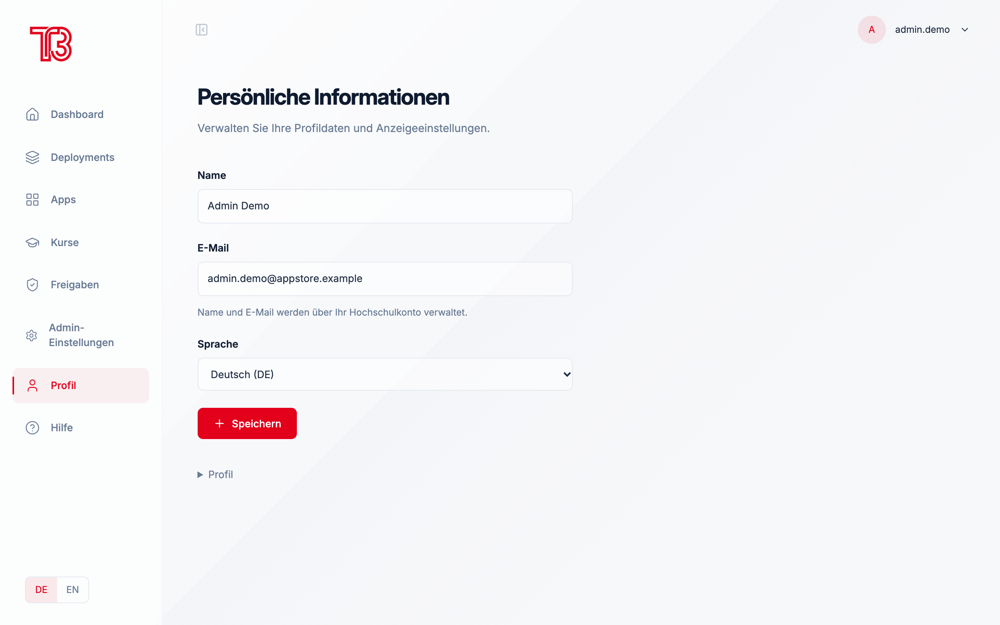
  <figcaption style="font-size: 0.9em; color: #555;">Profil: Übersicht der eigenen Benutzerdaten</figcaption>
</figure>

---

### Admin-Ansicht aktivieren

Über **Admin-Einstellungen** in der linken Seitenleiste können Sie die **Admin-Ansicht** ein- und ausschalten.

* **Admin-Ansicht aus (Standard):** Sie sehen die Oberfläche wie ein Dozent.
* **Admin-Ansicht ein:** Es werden zusätzliche Verwaltungsfunktionen eingeblendet, zum Beispiel die Versionsverwaltung auf App-Detailseiten und empfohlene Apps.

Die Einstellung wird pro Benutzer gespeichert und bleibt über Browser-Neustarts hinaus erhalten.

---

### Apps anlegen und einreichen

Über den Menüpunkt **Apps** gelangen Sie zur App-Übersicht. Als Admin können Sie neue Apps anlegen und den Prüfprozess anstoßen.

> **Hinweis:** Auch von Admins angelegte Apps durchlaufen den regulären Review-Prozess. Das sorgt für maximale Sicherheit und ermöglicht bei Bedarf ein Vier-Augen-Prinzip. Sie können eine eingereichte App im Anschluss selbst direkt freigeben.

1. Klicken Sie oben rechts auf **+ App hinzufügen**.
2. Vergeben Sie einen **Namen** und tragen Sie eine **Beschreibung** ein.
3. (Optional) Laden Sie ein App-Logo hoch.
4. Fügen Sie den **Link zum GitHub-Repository** ein.
5. Entscheiden Sie über die **Sichtbarkeit** (Öffentlich/Privat).
6. Bei privaten Repositories: Laden Sie den technischen GitHub-User als Collaborator ein.
7. Haken Sie **„Alle Versionen einreichen"** an.
8. Klicken Sie auf **Hinzufügen**.

<figure style="margin-bottom: 30px;">
  
  <figcaption style="font-size: 0.9em; color: #555;">App hinzufügen</figcaption>
</figure>

---

### App-Übersicht (Admin)

Als Admin sehen Sie in der App-Übersicht **alle** bisher angelegten Apps — unabhängig davon, ob sie öffentlich oder privat sind und welcher Nutzer sie erstellt hat.

* **Filterfunktion:** Filtern Sie über die Tabs nach *Alle*, *Empfohlen*, *Öffentlich* oder *Privat*.
* **Empfohlene Apps:** Mit aktivierter Admin-Ansicht können Sie pro App einen Schalter setzen, um sie als „Empfohlen" zu markieren. Empfohlene Apps erscheinen im App-Katalog als erster Tab.

<figure style="margin-bottom: 30px;">
  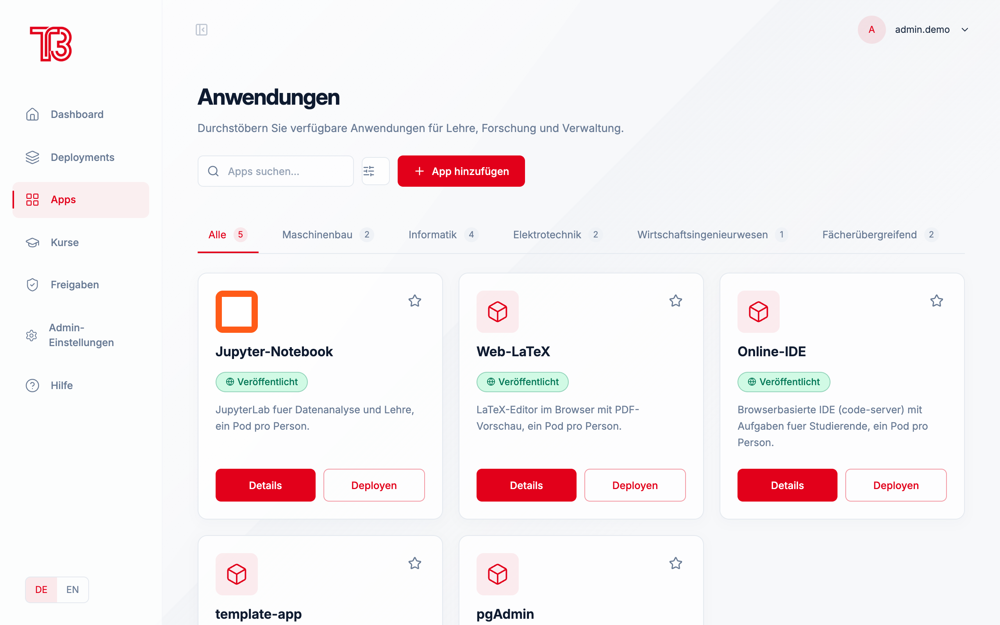
  <figcaption style="font-size: 0.9em; color: #555;">App-Übersicht (Admin)</figcaption>
</figure>

---

### App-Details einsehen und verwalten (Admin)

Auf der Detailseite einer App stehen Ihnen mit aktivierter Admin-Ansicht zusätzliche Funktionen zur Verfügung:

* **Bearbeiten / Löschen:** Oben rechts auf der Übersichtsseite.
* **Deploy-Version festlegen:** Über den Button **Version festlegen** legen Sie fest, welche Version für alle Nutzer beim Deployment vorausgewählt wird. Nur freigegebene Versionen können festgelegt werden.
* **Tab App Store:** Sichtbarkeit der App umschalten und Freigabe-Status der Versionen einsehen.
* **Link zum Git-Repository:** Unter dem App-Namen wird der Link zum Quell-Repository angezeigt. Dieser Link ist nur in der Admin-Ansicht sichtbar — Dozenten und Studenten sehen ihn auf der App-Detailseite nicht. Den Git-Link finden alle Rollen jedoch auf der Deployment-Detailseite unter dem Bereich **App**.

<figure style="margin-bottom: 30px;">
  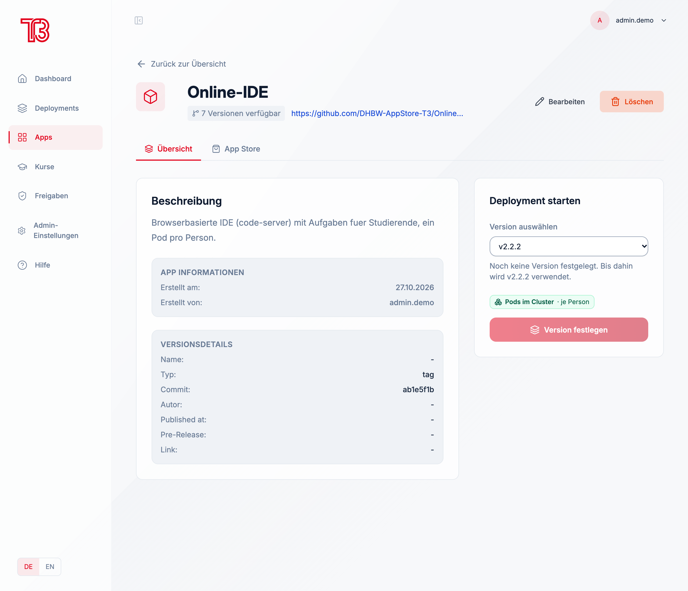
  <figcaption style="font-size: 0.9em; color: #555;">App-Details (Admin-Ansicht)</figcaption>
</figure>

---

### Kurse verwalten

In der Kursverwaltung sehen Sie als Admin alle auf der Plattform angelegten Kurse und können jeden davon bearbeiten oder löschen. Der Ablauf ist identisch mit dem der Dozenten-Rolle (siehe Abschnitt 2).

---

### Deployments

Über den Menüpunkt **Deployments** sehen Sie als Admin die Deployments **aller Nutzer**. Der Deployment-Prozess und die Detailansicht sind identisch mit der Dozenten-Rolle (siehe Abschnitt 2).

<figure style="margin-bottom: 30px;">
  
  <figcaption style="font-size: 0.9em; color: #555;">Übersicht über alle Deployments</figcaption>
</figure>

---

### App-Freigaben verwalten

Als Admin können Sie neue App-Versionen prüfen, freigeben oder sperren.

Über den Menüpunkt **Apps** → Tab **Admin-Freigaben** sehen Sie alle ausstehenden Einreichungen.

* **Filter ausschalten:** Zeigt alle öffentlichen und privaten Apps.
* **Detailansicht:** Klicken Sie auf eine App, um alle eingereichten Versionen und deren Status einzusehen.

<figure style="margin-bottom: 30px;">
  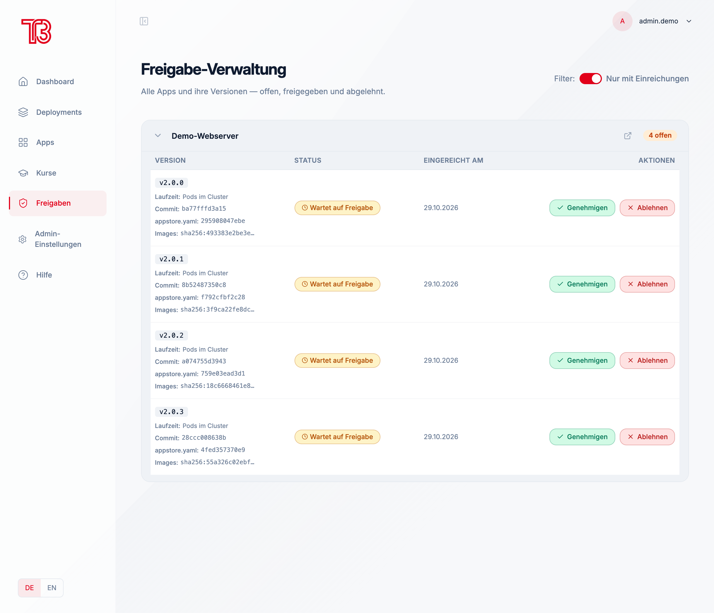
  <figcaption style="font-size: 0.9em; color: #555;">Freigabe-Verwaltung: Übersicht der ausstehenden App-Freigaben</figcaption>
</figure>

#### App-Versionen freigeben oder ablehnen

| Aktion | Ablauf | Auswirkung |
| :--- | :--- | :--- |
| **Genehmigen** | Klicken Sie bei der ausstehenden Version auf **Genehmigen**. | Die Version wird sofort für alle Nutzer freigeschaltet. |
| **Ablehnen** | Klicken Sie auf **Ablehnen** und geben Sie einen Ablehnungsgrund an (Pflichtfeld). | Die Version wird nicht freigeschaltet. Der Nutzer sieht Ihre Begründung. |
| **Widerrufen** | Klicken Sie bei einer bereits genehmigten Version auf **Widerrufen** und geben Sie einen Grund an (Pflichtfeld). | Die Version wird für alle Nutzer sofort gesperrt. |

> **Gut zu wissen:** Sowohl abgelehnte als auch widerrufene Versionen können Sie zu einem späteren Zeitpunkt jederzeit manuell **erneut genehmigen**.

<figure style="margin-bottom: 30px;">
  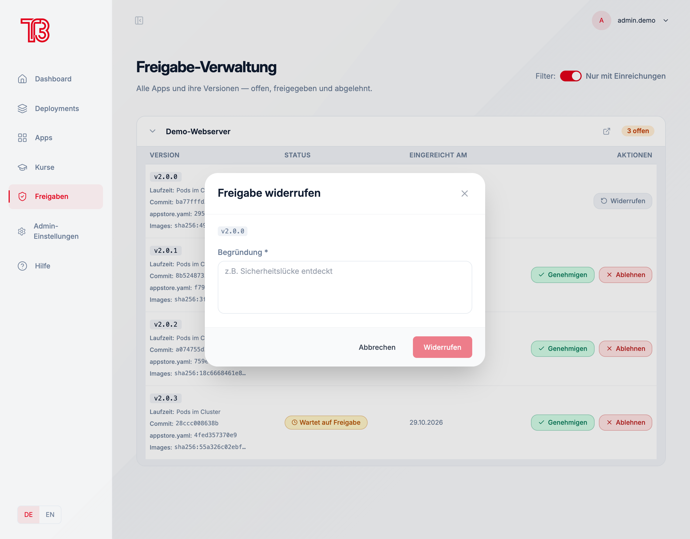
  <figcaption style="font-size: 0.9em; color: #555;">Freigabe-Verwaltung: Freigabe widerrufen</figcaption>
</figure>

---

### Hilfe und Support

Ganz unten in der linken Seitenleiste finden Sie den Punkt **Hilfe**.

* **Wenn etwas nicht funktioniert:** Checklisten zur Fehlerbehebung.
* **Schritt-für-Schritt-Anleitungen:** Erklärungen zu grundlegenden Prozessen der Plattform.
* **Nützliche Links:** Verlinkungen zum Projekt-Repository und zur technischen Dokumentation.

<figure style="margin-bottom: 30px;">
  
  <figcaption style="font-size: 0.9em; color: #555;">Hilfe & Q/A: Support, Anleitungen und weiterführende Links</figcaption>
</figure>

---
