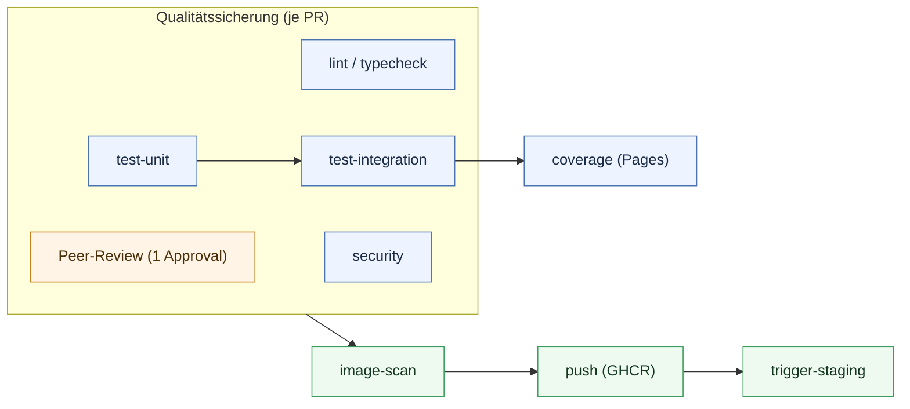

# QS-Maßnahmen — Beleg der Durchführung

> **Hinweis (Oktober 2026, [#12](https://github.com/DHBW-AppStore-T3/.github/issues/12)):** Dieses Dokument beschreibt teilweise den früheren Ablauf, bei dem Apps als OpenStack-VMs ausgerollt wurden (Packer, Terraform, OpenStack-Credentials, Quotas, Infrastructure-Ansicht). Alle Apps laufen inzwischen als **Pods** im Kubernetes-Cluster und werden über eine `appstore.yaml` beschrieben (Vertrag und Beispiele: [app-registry](https://github.com/DHBW-AppStore-T3/app-registry)). Die Windows-App folgt über KubeVirt. Aussagen zu den genannten VM-Themen sind überholt; das Dokument wird bei Gelegenheit überarbeitet.

> **Projekt:** OpenStack AppStore (six7-click-n-deploy)
> **Organisation:** [`github.com/six7-click-n-deploy`](https://github.com/six7-click-n-deploy)
> **Stand:** 25.07.2026
> **Zweck:** Nachweis der durchgeführten Qualitätssicherungs­maßnahmen im Studienprojekt.

### Autoren
1. **Okan Sönmez**

### Reviewer (Prüfer)
1. **Leon Priemer**

---

## 1. Überblick der QS-Maßnahmen

Die Qualitätssicherung des Projekts stützt sich auf vier ineinandergreifende Säulen:

| Säule | Maßnahme | Wo belegt |
|---|---|---|
| **1. Code-Review** | Verpflichtende Pull Requests, mind. 1 Review-Approval, Branch-Schutz | GitHub PRs + Ruleset |
| **2. Automatisierte Tests** | Unit- + Integrationstests, Coverage-Reporting | CI-Pipeline (`test`-Jobs) |
| **3. Statische Analyse** | Linting, Type-Checking, Formatierungs-Checks | CI-Pipeline (`lint`/`typecheck`) |
| **4. Security** | Dependency-Audit, Container-Scan, Secret-Scan, IaC-Scan | CI-Pipeline (`security`/`image-scan`), Gitleaks |

Der Code ist auf vier eigenständige Repositories aufgeteilt, die jeweils eine vollständige eigene Pipeline besitzen:

| Repository | Rolle | Sprache/Stack |
|---|---|---|
| [`frontend`](https://github.com/six7-click-n-deploy/frontend) | Single-Page-App (AppStore-UI) | Vue 3, TypeScript, Vite |
| [`backend`](https://github.com/six7-click-n-deploy/backend) | REST-API | FastAPI, Python 3.11 |
| [`worker`](https://github.com/six7-click-n-deploy/worker) | Async-Deployment-Worker | Celery, Python 3.11 |
| [`deployment`](https://github.com/six7-click-n-deploy/deployment) | Infrastruktur & CD | Terraform, Ansible |

---

## 2. Code-Review (Pull-Request-Prozess)

### 2.1 Prozess & Absicherung

Änderungen gelangen ausschließlich über Pull Requests nach `main`; direktes Pushen ist unterbunden. Jeder PR durchläuft die CI-Gates (Abschnitt 3–5) und ein Review durch ein anderes Teammitglied, bevor er gemergt wird.

Dieser Prozess ist in allen vier Repositories technisch über ein Ruleset „protect main" erzwungen:

- `pull_request` erforderlich, mindestens ein genehmigendes Review (`required_approving_review_count: 1`)
- Löschschutz für `main` (`deletion`)
- kein Force-Push (`non_fast_forward`)

Ein [Pull-Request-Template](https://github.com/six7-click-n-deploy/frontend/blob/main/.github/pull_request_template.md) führt Reviewer zusätzlich durch eine strukturierte Checkliste (Art der Änderung, Testnachweis, Self-Review, i18n, Typisierung).

### 2.2 Belegbare Kennzahlen (Stand 25.07.2026)

Über die drei Code-Repos wurden **121 von 127 Pull Requests** nach `main` gemergt (`frontend` 68/70, `backend` 32/35, `worker` 21/22) — jeder davon über den beschriebenen PR-Prozess.

> `deployment` ist ein reines Infrastruktur-/CD-Repo (kaum Anwendungscode) und wird hier nicht mitgezählt — die QS erfolgt dort über Gitleaks-Secret-Scan und IaC-Scan (Abschnitt 5.4/5.5).
>
> Nachprüfbar im PR-Tab jedes Repos, z. B. [`frontend/pulls`](https://github.com/six7-click-n-deploy/frontend/pulls?q=is%3Apr).

---

## 3. Automatisierte Tests

Jedes Code-Repository führt bei jedem PR und jedem Push auf `main` eine Testsuite aus. Ein PR ist erst mergefähig, wenn die Tests bestehen.

### 3.1 Backend (`backend`) — FastAPI / pytest

- `test-unit`: Unit-Tests (`pytest -m unit`) gegen einen PostgreSQL-16-Service-Container
- `test-integration`: End-to-End-Tests der FastAPI-App via `TestClient` (`pytest -m integration`)
- `coverage`: Kombiniert Unit- + Integrations-Coverage, rendert HTML-Report, erzeugt ein Shields.io-Coverage-Badge und veröffentlicht den Report auf GitHub Pages
- Testumfang: 659 Test-Cases, 77 % Statement-Coverage

### 3.2 Worker (`worker`) — Celery / pytest

- `test-unit` + `test-integration` (getrennte Marker), ebenfalls mit Coverage-Aggregation und Pages-Publishing
- Testumfang: 334 Test-Cases, 91 % Statement-Coverage

### 3.3 Frontend (`frontend`) — Vitest

- `test`: `npm run test:coverage` (Vitest) inkl. Coverage-Badge-Erzeugung
- `typecheck`: `vue-tsc --noEmit` als eigener Blocking-Job
- Testumfang: 101 Test-Cases, 71 % Statement-Coverage

### 3.4 Coverage-Transparenz

Alle drei Code-Repos publizieren ihren Coverage-Report automatisch auf GitHub Pages und erzeugen ein Coverage-Badge. Die aktuellen Reports sind direkt einsehbar:

| Repository | Coverage-Report |
|---|---|
| `frontend` | [six7-click-n-deploy.github.io/frontend](https://six7-click-n-deploy.github.io/frontend/) |
| `backend` | [six7-click-n-deploy.github.io/backend](https://six7-click-n-deploy.github.io/backend/) |
| `worker` | [six7-click-n-deploy.github.io/worker](https://six7-click-n-deploy.github.io/worker/) |

---

## 4. Statische Analyse (Linting, Formatierung, Typen)

Vorgeschaltete Qualitäts-Gates fangen Stil- und Typfehler ab, bevor Tests laufen:

| Repository | Werkzeug(e) | Prüfung |
|---|---|---|
| `backend` | Ruff | Linting (`ruff check .`) |
| `worker` | Ruff, Black, isort, MyPy | Linting, Formatierung, Import-Ordnung, statische Typen |
| `frontend` | vue-tsc | TypeScript-Typprüfung (`--noEmit`) |

Diese Jobs sind blockierend — schlägt das Linting fehl, kann der Build-Job nicht starten.

---

## 5. Security-Maßnahmen

Security ist als fester Pipeline-Bestandteil integriert und blockiert Merges bei HIGH-/CRITICAL-Findings.

### 5.1 Dependency-Scanning

| Repository | Werkzeug | Verhalten |
|---|---|---|
| `backend` / `worker` | pip-audit (`--strict`) | Prüft Produktions­abhängigkeiten, bricht bei Vulnerabilities ab |
| `frontend` | npm audit (`--audit-level=high --omit=dev`) | Prüft Produktions­abhängigkeiten |

Dokumentierte, begründete Ausnahmen werden nachvollziehbar hinterlegt — z. B. wird im Backend `PYSEC-2026-1325` (ecdsa Minerva-Timing-Seitenkanal) mit ausführlicher Begründung ignoriert, da der betroffene Code-Pfad (Signieren) nicht genutzt wird (nur Token-Verifikation).

### 5.2 Filesystem- & Misconfig-Scan (Trivy)

Der `security`-Job führt in jedem Repo einen `trivy fs`-Scan aus (`vuln,secret,misconfig`):

- Blocking Gate: Job schlägt bei HIGH/CRITICAL fehl (`exit-code: 1`)
- SARIF-Upload: Alle Findings (auch ignorierte) landen im GitHub Security Tab

### 5.3 Container-Image-Scan (Trivy)

Der `image-scan`-Job baut das produktive Docker-Image und scannt es mit Trivy auf CVEs (HIGH/CRITICAL, blockierend + SARIF-Upload). Erst danach darf das Image via `push`-Job in die GitHub Container Registry (GHCR) gelangen. Die veröffentlichten Images sind öffentlich einsehbar:

| Repository | Container-Image |
|---|---|
| `frontend` | [ghcr.io/six7-click-n-deploy/frontend](https://github.com/six7-click-n-deploy/frontend/pkgs/container/frontend) |
| `backend` | [ghcr.io/six7-click-n-deploy/backend](https://github.com/six7-click-n-deploy/backend/pkgs/container/backend) |
| `worker` | [ghcr.io/six7-click-n-deploy/worker](https://github.com/six7-click-n-deploy/worker/pkgs/container/worker) |

### 5.4 Secret-Scanning (Gitleaks)

Das `deployment`-Repo betreibt einen dedizierten [Secret-Scan-Workflow](https://github.com/six7-click-n-deploy/deployment/blob/main/.github/workflows/secret-scan.yml) mit Gitleaks als Pre-Merge-Gate:

- Scannt die vollständige Git-Historie (`fetch-depth: 0`) auf versehentlich committete Tokens, SSH-Keys und OpenStack-Credentials
- Zwei-Pass-Muster: blockierendes Gate + SARIF-Emit in den Security Tab

### 5.5 Infrastructure-as-Code-Scan

Die Staging-Deploy-Pipeline (`deployment/staging.yml`) prüft die Terraform-Konfiguration:

- `terraform fmt -check` (Formatierung)
- `terraform validate` (Syntax/Konsistenz)
- `trivy config` auf IaC-Misconfigurations (HIGH/CRITICAL, SARIF in Security Tab)
- Sensible Artefakte (SSH-Keys, Inventory) werden nach dem Lauf garantiert gelöscht (`if: always()`)

---

## 6. QS-Pipeline (Gesamtablauf)

Jede Änderung durchläuft dieselbe Kette von Qualitätssicherungs-Stationen, bevor sie nach `main` gelangt und deployt wird. Peer-Review und automatische Gates greifen parallel; erst wenn beide bestanden sind, ist ein Merge möglich (technisch über das Ruleset erzwungen, Abschnitt 2):

- **Zwei-Augen-Prinzip:** Jeder PR braucht mindestens ein Approval eines anderen Teammitglieds — technisch erzwungen (Abschnitt 2)
- **Automatische Gates:** Linting/Typen, Unit- + Integrationstests und Security-Scan müssen grün sein
- **Merge-Gate:** Erst wenn Review **und** alle Gates bestanden sind, ist ein Merge nach `main` möglich
- **Continuous Deployment:** Nach dem Merge durchläuft die Änderung `image-scan → push (GHCR)` und triggert automatisch das Staging-Deployment

### 6.1 Pipeline-Läufe

Die vollständige Run-Historie jeder Pipeline ist im **Actions-Tab** des jeweiligen Repos einsehbar und reproduzierbar:

| Repository | Workflow-Historie |
|---|---|
| `frontend` | [Actions](https://github.com/six7-click-n-deploy/frontend/actions/workflows/ci.yml) |
| `backend` | [Actions](https://github.com/six7-click-n-deploy/backend/actions/workflows/ci.yml) |
| `worker` | [Actions](https://github.com/six7-click-n-deploy/worker/actions/workflows/ci.yml) |
| `deployment` | [Actions](https://github.com/six7-click-n-deploy/deployment/actions) |

> Die Historie enthält auch fehlgeschlagene Läufe — die Gates greifen also und fangen fehlerhafte Änderungen vor dem Merge nach `main` ab.

---

## 7. Zusammenfassung — Nachweis der Durchführung

Die beschriebenen QS-Maßnahmen wurden über die gesamte Projektlaufzeit angewendet, nicht nur konzipiert. Konkret belegbar:

- 121 von 127 Pull Requests nach `main` gemergt, in allen vier Repositories über ein technisch erzwungenes Ruleset (PR-Pflicht, Review, kein Force-Push) abgesichert
- 1.094 automatisierte Test-Cases (Backend 659, Worker 334, Frontend 101) mit Statement-Coverage von 91 % (Worker), 77 % (Backend) und 71 % (Frontend), automatisch auf GitHub Pages veröffentlicht
- statische Analyse (Ruff, Black, isort, MyPy, vue-tsc) und Security-Scanning auf vier Ebenen (pip-audit/npm audit, Trivy fs + image, Gitleaks, Trivy config) als blockierende Gates
- eine durchgängige CI/CD-Pipeline mit strikten Job-Abhängigkeiten und automatischem Staging-Deployment

Alle Belege sind über die GitHub-Organisation, die Workflow-Dateien (`.github/workflows/`) und die PR-/Actions-Tabs der Repos nachprüfbar.
